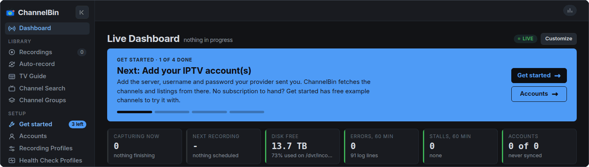
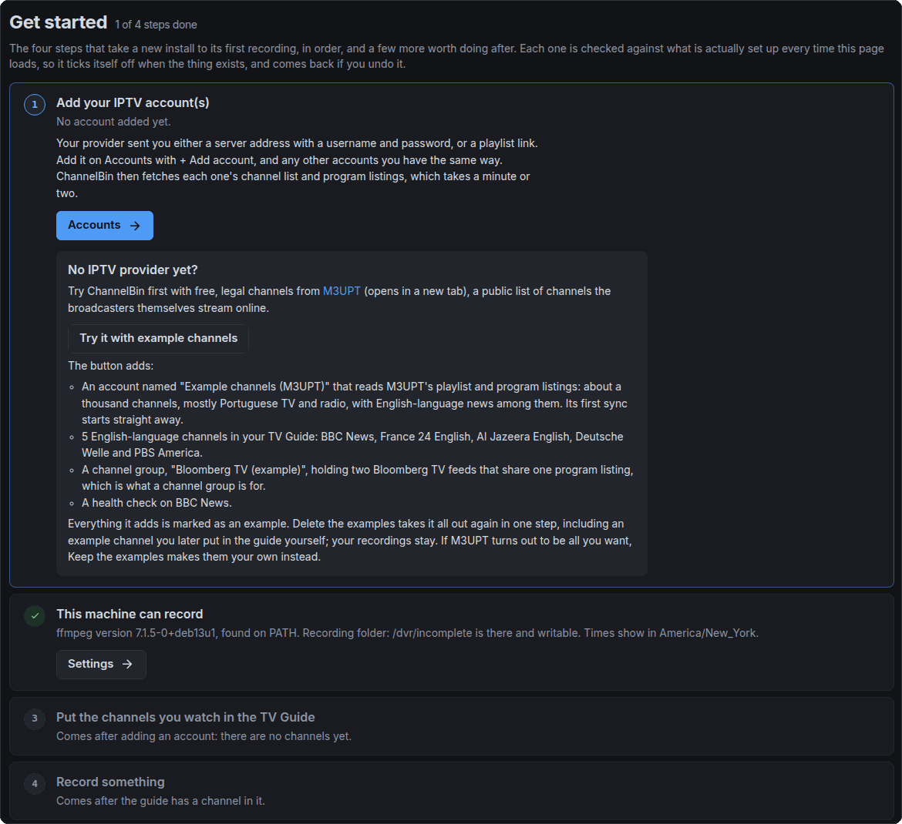
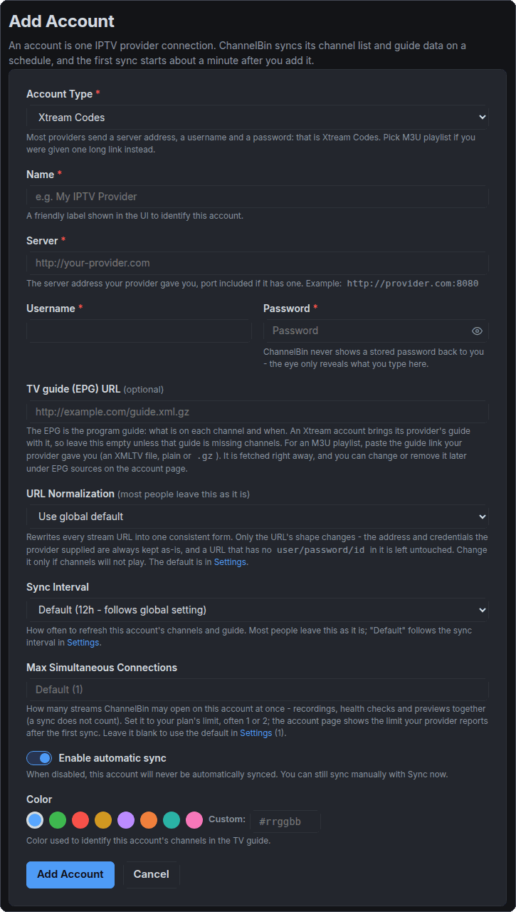
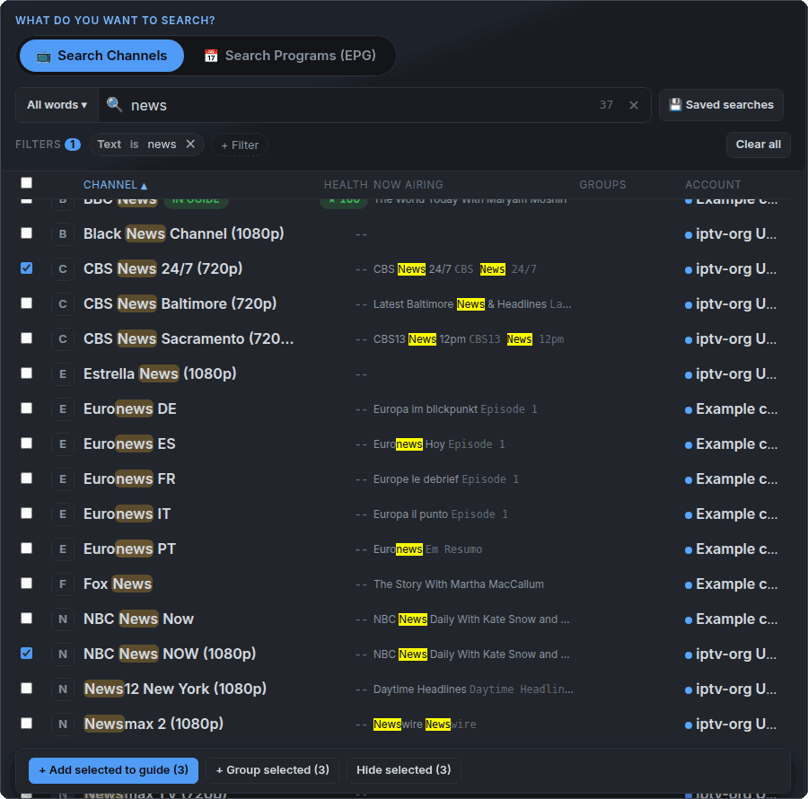
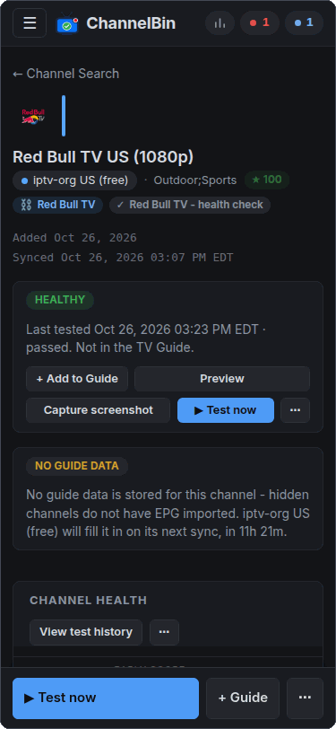
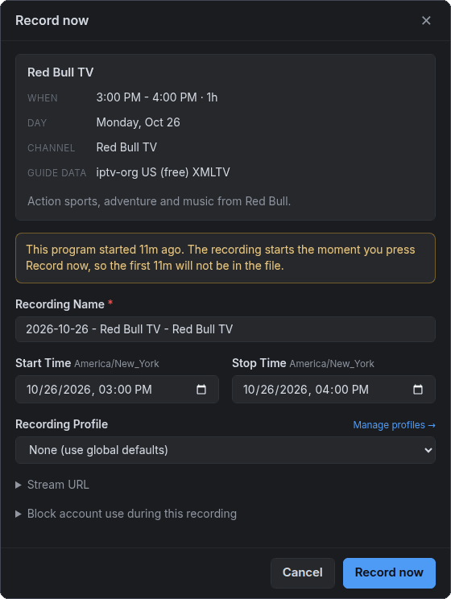

# Quick start: from a new install to your first recording

This guide picks up once ChannelBin is installed and running (the [README](../README.md#install)
covers Docker, Unraid and running it directly) and ends with a recording on disk. It follows the
screens in the order a new install shows them, so if you would rather just click around, the app
will walk you through the same four steps on its own. What comes after the first recording is in
the [user guide](USER-GUIDE.md).

## What you need

- ChannelBin open in a browser, at `http://<your server>:5000` unless you mapped a different port.
- Your IPTV subscription details. Providers send one of two things:
  - **a server address, a username and a password** (most of them), or
  - **one long playlist link**, usually ending in something like `type=m3u_plus`, and sometimes a
    second link for the program guide.
- **How many streams your plan allows at once.** It is often 1 or 2. ChannelBin uses this to
  avoid opening more connections than your provider permits.

No IPTV provider yet? You can try everything below with free example channels first. See
[Trying it without an IPTV provider](#trying-it-without-an-iptv-provider).

## The setup banner and Get started

A new install opens on the Dashboard with a banner across the top: **Get started · 1 of 4
done**, the step to do next, and a progress bar. The banner has two buttons. **Get started**
opens the full list of steps, and the second button goes straight to the page where the next
step is done.

The four steps are:

1. Add your IPTV account(s)
2. This machine can record
3. Put the channels you watch in the TV Guide
4. Record something

Each step is checked against what is actually set up every time the page loads. You never tick
anything off by hand, and nothing can be dismissed. A step is done because the thing exists, so
if you delete your only account later, the step comes back. Step 2 is usually done before you
start, which is why a brand-new install already says "1 of 4 done".

**Get started** also shows in the menu, under Setup, with how many steps are left. Once all
four are done, the banner and the menu link go away. You can still reach the page from the
Readiness check on Maintenance.

## Step 1: Add your account

Go to **Accounts** and click **+ Add Account**.

- **Account Type.** Leave it on **Xtream Codes** if your provider sent a server, a username and a
  password. Pick **M3U playlist** if you were given one long link instead.
- **Name** is just a label for you, such as the provider's name.
- **Server, Username, Password** (Xtream Codes): copy them from your provider's email. Include
  the port in the server address if they gave you one, for example `http://provider.com:8080`.
- **M3U URL** (M3U playlist): paste the whole link.
- **TV guide (EPG) URL** is optional. An Xtream Codes account brings its provider's program
  guide with it, so leave this empty unless that guide turns out to be missing channels. For an
  M3U playlist, paste the guide link your provider gave you, if they gave you one.
- **Max Simultaneous Connections.** Set this to your plan's limit. The default is 1. Recordings,
  health checks and live previews all count against it.
- Leave **URL Normalization** and the rest alone unless you know you need them.

Click **Add Account**. The message that comes up says when the first sync starts, which is
usually in about a minute. To start it right away, open the account's **⋯** menu and choose
**Sync now**.

The first sync fetches the channel list and the program listings. On a big provider it can take
a minute or two. The account shows its channel count as the sync runs, and Get started moves on
by itself when it finishes. After that, accounts sync on their own every 12 hours by default.

**If the first sync fails**, Get started flags the step and shows the first line of the error.
The account's page shows the provider's own answer. Check the server, username and password
there, then use **Sync now** to try again.

**"Hidden" channels.** After the sync the account may say something like "3 hidden". ChannelBin
comes with a few **Hide Rules** that hide the divider rows some providers put between sections
of their channel list, such as `#### US CLASSIC ####`, because they are not real channels. Click
the count to see the rules. You can edit or delete them like any rule you make yourself.

## Step 2: This machine can record

ChannelBin checks that ffmpeg and ffprobe are installed, that the recording folder exists and
can be written to, that there is free space, and that the database, the scheduler and the
timezone are all working. On the Docker image all of this is normally fine before you touch
anything.

If something is wrong, the step is flagged, names the problem and links to where to fix it. It
ticks itself off once the problem is fixed. The usual cause is a recording folder the app's user
cannot write to. See PUID / PGID in the [README](../README.md#puid--pgid).

## Step 3: Put the channels you watch in the TV Guide

The TV Guide starts empty on purpose. A provider's list is often thousands of channels, most of
them nothing you would watch, and each channel in the guide also gets a health check every
night. So you pick the ones you want.

1. Open **Channel Search** from the menu and make sure **Search Channels** is picked at the top.
   It shows one row per channel.
2. Type part of a channel's name. It searches channel names unless you tell it otherwise.
3. Add the channels you want:
   - **One at a time:** open the channel and click **+ Add to Guide** at the top of its page. On
     a phone it is **+ Guide** in the bar along the bottom of the page.
   - **Several at once:** tick their rows and click **+ Add selected to guide** in the bar that
     appears.

While you are on a channel's page, **Preview** plays the channel live right there. It is the
quickest way to see that you picked the right channel and that it plays. A preview uses one of
your account's connections while it runs, and gives it up if a recording needs it.

Each channel you add joins the **TV Guide health check**, which ChannelBin keeps by itself. It
tests every channel in your guide every night at 2 AM, so the channel's health score means
something by the time you depend on it.

## Step 4: Record something

Open the **TV Guide** and click a program.

- For a program that has not started, the dialog's button is **Schedule recording**.
- For a program that is already on, the button is **Record now**. The dialog says how long ago it
  started and that **that part will not be in the file**. ChannelBin can only record from the
  moment you press the button.

The dialog also lets you change the recording's name, start and stop times, and recording
profile. You can leave the **Stream URL** folded away; it is only there if you want to copy the
link into another player.

Once you press the button, the program's cell in the guide reads **Starting**, then
**Recording** within a few seconds. The menu's Dashboard entry shows a count while anything
records, and the Dashboard lists it with its live numbers. Click the recording to open its page.

### If the stream drops

This is what ChannelBin was built for. If the stream stalls or the connection drops, ChannelBin
notices within about 30 seconds, reconnects and carries on in a new segment. At the end it joins
the segments into one file. The strip at the top of the recording's page always says which state
it is in:

- **Recording**: data is coming in.
- **Connecting**: it is opening the stream.
- **Not capturing**: nothing is coming in. The strip says for how long and whether ChannelBin is
  reconnecting.

If a stream stays dead through repeated restarts, the recording goes to **RETRYING**. ChannelBin
keeps trying, waiting a little longer each time (1 minute, then 2, then 5, then up to 10), until
the stream comes back, it has tried 10 times, or the program's stop time comes. If the channel
is in a channel group, it moves to another copy of the channel first (see the
[user guide](USER-GUIDE.md#channel-groups-and-failover)).

The **What happened** card on the recording's page tells the story in plain words: when the
stream dropped, how long nothing was captured, how many restarts it took, and whether the stream
came back. It names who was at fault only when it actually knows, for example when the provider
sent its "channel offline" placeholder or refused the login. If nothing ChannelBin saw says
whether the provider, the network or the channel was to blame, it says that instead of guessing.
The **Event log** below it has the full detail.

### When it finishes

When the recording ends, its status moves through **JOINING** (the segments become one file),
**ANALYZING** (the file is checked for damage), and **CONVERTING** (by default the file is
converted to MP4 and the original `.ts` is deleted). Then it is **COMPLETED**.

In the TV Guide a finished recording is marked:

- **Recorded**, with a ✓: everything it was scheduled to record is in the file.
- **Partial**, in amber: part of the program is missing, and the recording's page says why and
  how much.
- **Stopped early**: you stopped it yourself and nothing else was lost.

## Where your file is

**Play** on a finished recording's page plays it right in the browser, and **Download file** in
its **⋯** menu saves it to your computer. The file itself is in your recording folder (`/dvr` by
default; on Docker, wherever you mapped that volume), named from the date, the title, the
episode and the channel. **Copy output path** on the recording's page gives you its exact path,
so you can also play it with any player that opens MP4 files, or point Plex, Jellyfin or Emby at
the folder.

## Trying it without an IPTV provider

On a brand-new install with no account, Get started's first step has a box headed **No
IPTV provider yet?** Its button, **Try it with example channels**, asks once and then adds:

- an account, "Example channels (M3UPT)", that reads M3UPT's public list of free channels the
  broadcasters themselves stream online: about a thousand channels, mostly Portuguese TV and
  radio, with English-language news among them,
- five English-language channels in your TV Guide: BBC News, France 24 English, Al Jazeera
  English, Deutsche Welle and PBS America,
- a channel group, "Bloomberg TV (example)", holding two Bloomberg TV feeds that share one
  program listing, which shows what a channel group is for, and
- a health check on BBC News.

The first sync takes a minute or two and Get started moves on by itself. You can then record,
preview and test with them like any other channels. The example channels count as a trial: the
account step stays open until you add an account of your own or keep the examples.

When your subscription arrives, open Get started and choose one of:

- **Delete the examples** takes out the example account and everything on its channels, in one
  step. That includes an example channel you put in the guide or tested yourself. Your
  recordings stay, including ones made from an example channel, and so does everything on your
  own accounts.
- **Keep the examples** makes them an ordinary account and channel group, if M3UPT is all you
  want.

## Then: the Readiness check

The four steps are what you have to do. The **Readiness check** on **Maintenance** tests the
rest: that each login still works, that every folder ChannelBin writes to is writable, that
search is indexed, and that a notification actually arrives. Some of its checks cost something
(they open a stream or send a message), so they wait for you to click the button that runs
them, which says how many are left, such as **Run 4 more checks**.

The numbers beside **Maintenance** in the menu come from it: red for things that are blocked,
amber for things that work but need attention. Point at a number to see what it counts. On a
new install most of them clear by themselves once an account is added and the guide has
channels in it.

## Next

The [user guide](USER-GUIDE.md) covers what most people set up next: getting told when
something breaks, recording a show every time it is on, grouping copies of the same channel so a
recording can fail over, and reading a recording's page in more detail.
