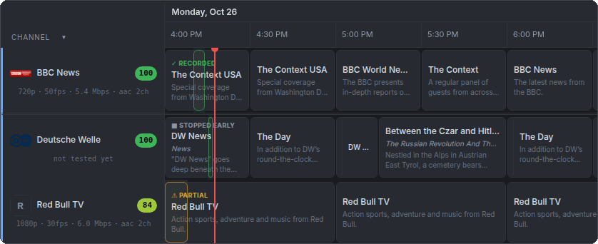
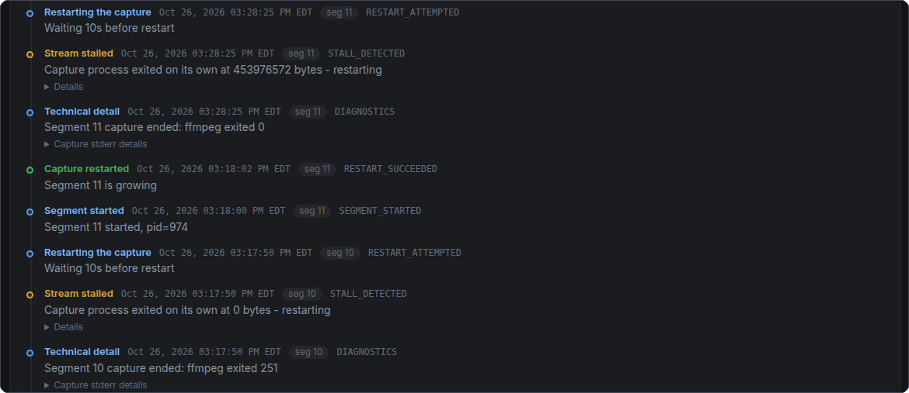
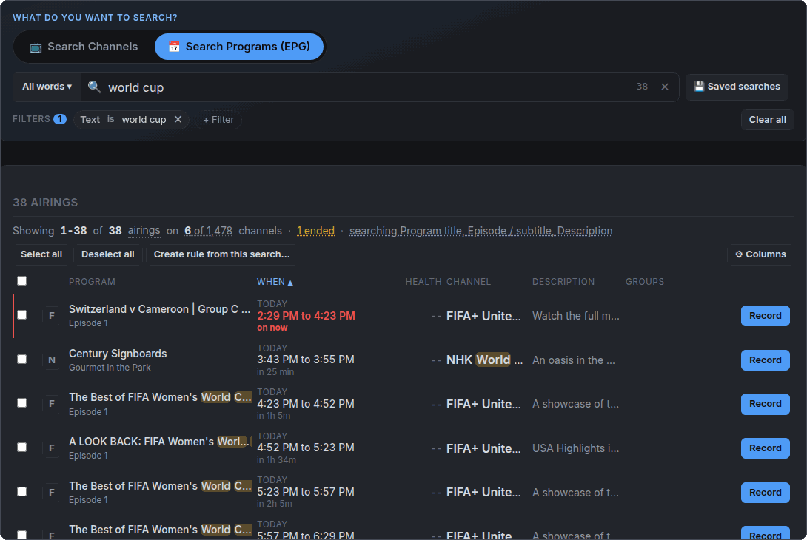
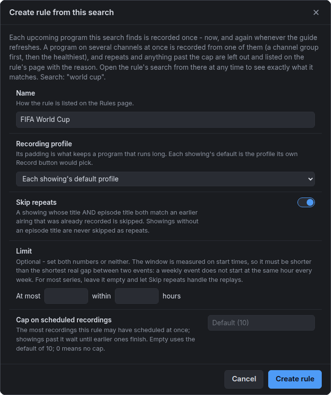
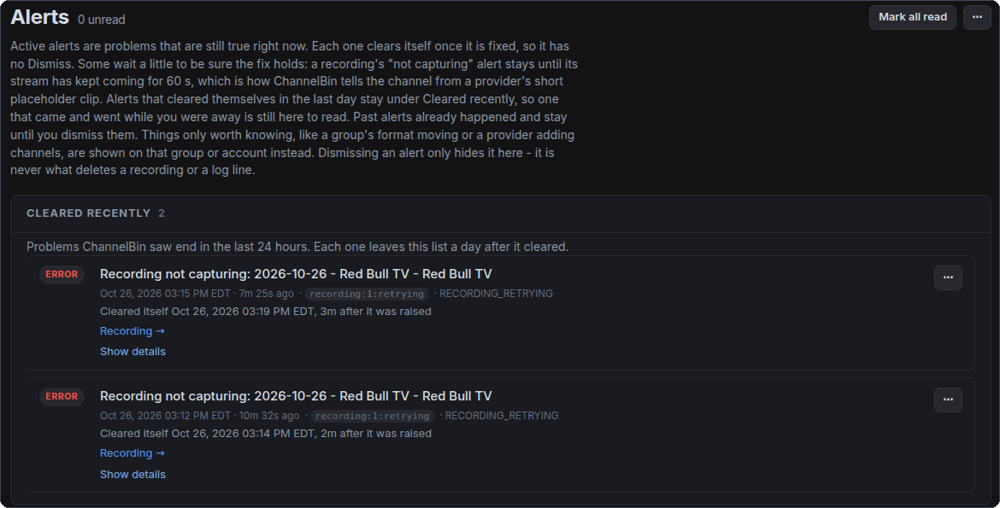

# User guide: after the first recording

The [quick start](QUICK-START.md) takes a new install to its first recording. This guide covers
what comes next: reading a recording's page properly, knowing which channels you can trust,
grouping copies of a channel so a recording can fail over, recording a show every time it is on,
and getting told when something breaks. Each section stands on its own, so skip to what you
need.

Install, configuration, network exposure, backups, upgrades and the Home Assistant integration
are in the [README](../README.md).

- [Reading a recording's page](#reading-a-recordings-page)
- [Health checks: can I trust this channel?](#health-checks-can-i-trust-this-channel)
- [Channel groups and failover](#channel-groups-and-failover)
- [Finding a show: Search Programs](#finding-a-show-search-programs)
- [Recording a show every time it is on](#recording-a-show-every-time-it-is-on)
- [Recording profiles](#recording-profiles)
- [What happens to the file: joining and conversion](#what-happens-to-the-file-joining-and-conversion)
- [Getting told when something breaks](#getting-told-when-something-breaks)
- [Keeping ChannelBin off an account while you watch](#keeping-channelbin-off-an-account-while-you-watch)
- [Hiding channels and tagging programs](#hiding-channels-and-tagging-programs)
- [Maintenance, Jobs and Logs](#maintenance-jobs-and-logs)
- [Settings](#settings)
- [Home Assistant](#home-assistant)

## Reading a recording's page

Open any recording from **Recordings**, the Dashboard or the TV Guide.

### The status

| Status | What it means |
|---|---|
| SCHEDULED | Waiting for its start time. In the guide it reads **Starting** for the few seconds between the start time and the capture actually starting. |
| RECORDING | Capturing now. |
| PAUSED | You paused it. Nothing is captured until you resume. |
| RETRYING | The stream stayed dead through repeated restarts. ChannelBin is waiting to try again; the page says when. |
| JOINING | The capture is over and the segments are being joined into one file. |
| ANALYZING | The joined file is being checked for damage. On a long recording this can take a few minutes. |
| CONVERTING | The file is being converted, to MP4 by default. |
| WAITING | Ready to analyze or convert, waiting for another recording to finish using the machine. |
| COMPLETED | Done. The file is on disk. |
| FAILED | Nothing usable could be captured. The page says why. |
| CANCELLED | You aborted it, or cancelled it before it started. |

While it records, the strip at the top says **Recording**, **Connecting**, or **Not capturing**
(with how long, and whether ChannelBin is reconnecting). That strip is the honest answer to "is
anything being saved right now", even when the status still says RECORDING.

### What happened

The **What happened** card is the first thing to read. It tells the recording's story in plain
words: when the stream dropped, how long nothing was captured, how many restarts it took,
whether a retry got the stream back, and whether it moved to another channel. When ChannelBin
knows whose fault a drop was (the provider sent its "channel offline" placeholder, refused the
login, or answered with an HTTP error), it says so. When it cannot tell whether the provider,
the network or the channel was at fault, it says that instead of guessing.

![A finished recording's page. What happened says the file holds 12m 30s of video, that the recording started 11 minutes into the program, that the stream stopped delivering video 14 times and a retry got it back, that 6m 17s of the window had nothing capturing, and that ChannelBin could not reach the server but cannot tell whose fault that was. The Details card below has a frame from the recording, a timeline of when it was capturing, and the file's size, video format, restarts, downtime and capture gaps.](screenshots/recording-what-happened.png)

A few numbers on the page are easy to mix up:

- **Downtime** is all the time nothing was being recorded, including waits between retries.
- **Capture gaps** are holes in the file itself. They are mostly inside Downtime, so What
  happened gives them together.
- A file can hold a few seconds **more** than the capture ran, because the stream sends a little
  buffered video when it connects. What happened says so when it is enough to notice.
- The **scheduled** length (from the guide), the **captured** length (what is in the file) and
  the **program** length can all differ. A recording started late or stopped early is shorter
  than its program.

### Finished: Recorded, Partial or Stopped early

In the TV Guide and on the Dashboard, a completed recording is one of:

- **Recorded** (✓): the whole scheduled window is in the file.
- **Partial** (amber ⚠): part of it is missing. The page says what and why.
- **Stopped early** (grey ■): you stopped it, and nothing else was lost.

### The event log

The **Event log** lists everything that happened to the recording, in order, each in plain words
with its internal name beside it in small print. It is the detail behind What happened. If you
report a problem, this is what to copy.

### What you can do from the page

- **Stop** ends a recording gracefully and keeps everything captured so far.
- **Pause** stops capturing and frees the connection until you resume. The paused time is a gap
  in the file.
- **+30 min** pushes the stop time half an hour later, for a game that runs long. **Edit
  schedule** changes the times of a scheduled recording.
- **Switch channel** moves a running recording to another copy of the channel in its group.
- **Abort** (in the **⋯** menu) kills the recording and discards what it captured. Use Stop
  unless you really do not want the file.
- **Copy output path** gives you the file's location on disk. ChannelBin cannot play or
  download a finished recording from the browser yet.
- **Record again** on a finished recording, and **Find another airing** on one that went
  wrong, open a Programs search for the same title, so you can pick another showing on any of
  your channels.
- **Retry join** and **Retry conversion** show up when one of those steps failed and what it
  needs is still on disk.

## Health checks: can I trust this channel?

A **health check** opens a channel for a short while (30 seconds by default) and measures what
it sends: whether it plays, its resolution and frame rate, its bitrate, and whether it stalls.
It can also save a screenshot. Every result, and every recording made from the channel, feeds
the channel's **health score**.

### The health score

The score runs from 0 to 100 and is shown with a band: **Great** (90 and up), **Good** (80 and
up), **Fair** (50 and up) and **Poor** (below 50). It is a running average over the channel's whole life, so
one bad night does not sink a good channel, and recent results count more than old ones.

Until a channel has **3 observations** (tests or recordings), its score is marked as too early to
rely on. A single test that scores 100 only tells you the channel played that once. The channel's
page says how many more it needs.

### Running a check

- **Test now**, at the top of a channel's page (or in the bar along the bottom on a phone),
  checks that one channel straight away. The page updates itself when it finishes, usually in
  well under a minute.
- **Preview** is different: it plays the channel live in the page so you can look at it, but it
  measures nothing and does not change the score.
- **The TV Guide health check** is the one ChannelBin keeps by itself. It tests every channel in
  your TV Guide every night at 2 AM, so you do not need to set anything up for the channels you
  watch. It is listed on Channel Groups, under Automatic.
- **Your own scheduled health checks.** Every channel group carries one health check. Use the
  group's **Health check** menu to schedule it, run it now, pause it or skip its next run. A
  group with no channel turned on for recording is just a health check, which is a handy way to
  keep an eye on a set of channels you do not record.

Health checks honor your account's connection limit, and they stay out of the way of
recordings: a check due while something is recording, or about to start recording, is put off.

### Health Check Profiles

A health check profile bundles the test length, the wait between channels, screenshots, and the
connection retry settings, so you can pick them by name. Having none is normal. Every health
check uses the defaults in **Settings → Channel Health Checks** until you give it a profile.

## Channel groups and failover

Providers often carry the same channel more than once: an HD and an SD feed, a backup feed, or
the same channel on a second subscription. A **channel group** holds those copies.

- In the TV Guide the group can be **one row** instead of several.
- A recording from the group **starts on the copy with the best health score**.
- If that copy dies partway through, the recording **moves to the next-best copy** and carries
  on in the same file. What happened and the event log say when and why it moved.

This is the most useful thing to set up for the channels you care about most, and the reason the
health score exists.

### Making a group

- From **Channel Search**: tick the copies and click **+ Group selected**.
- From **Channel Groups**: click **+ New Group**, then **+ Add Channels** on the group's page.

On the group's page each channel has two switches:

- **Recording**: whether you would record from this copy. Only copies with Recording on are
  used for recordings and failover.
- **Health check**: whether the group's health check tests this copy.

Turn on **In Guide** to make the group a TV Guide row. A group in the guide always needs at least
one copy with Recording on, because a guide row that cannot record anything would look normal
and never produce a file. Turning off the last one asks first, then takes the group out of the
guide and cancels its scheduled recordings. While one of its recordings is running, ChannelBin
refuses instead.

### Different picture formats

Copies of a channel are not always the same resolution or frame rate. A group can be set to only
record from copies that match one format, so a recording does not switch from 1080p to 720p
halfway through. If no copy matches, the recording still runs, from the best copy available, and
the group's page and the recording both say so. Adding a channel of a different format to a
group is never refused; it is simply not picked while a format rule excludes it.

## Finding a show: Search Programs

**Channel Search** has two kinds of search, picked with the two pills at the top:

- **Search Channels**: one row per channel. "Which of my channels is this?"
- **Search Programs (EPG)**: one row per showing, from your accounts' program listings. "When is
  this on, and on which channel?" Type a show, a team or a word from a description, and every
  showing it finds has its time and a **Record** button.

Click into the search box to see **Search in**, which picks what your words are matched against
(channel name, category and ids, or program title, episode and description). **All words** or
**Any word**, beside the box, says whether every word has to match. **+ Filter** narrows the
results by account, category, health, channel group, tag or status, and for programs by when,
day and time of day. **Saved searches** keeps a search under a name.

Program searches only reach as far as your listings do, which is usually about three days ahead.

## Recording a show every time it is on

An **auto-record rule** is a Programs search that ChannelBin keeps running for you. Every
upcoming showing it finds is scheduled as an ordinary recording, now and again whenever the
listings refresh, so a weekly show or a team's games get recorded without you coming back.

1. Go to **Auto-record** and click **+ New rule**, or start from a search on Channel Search.
2. Search Programs for what you want until the results are exactly what you want recorded. The
   search becomes the rule, so what it shows is what the rule records.
3. Click **Create rule from this search...**, give it a name and choose its options:
   - **Recording profile** to record with.
   - **Skip repeats** so the same episode is not recorded twice.
   - **Limit** to at most so many recordings within so many hours.
   - **Cap on scheduled recordings**, how many it may have scheduled at once.

The Auto-record page lists each rule with its next recording and when it last checked. **Check
now** runs one straight away. If a check could not schedule everything it found, the rule says so.

## Recording profiles

A **recording profile** bundles a filename template, padding before and after the program, and
the failure and timeout limits a recording runs with. Pick one by name when you schedule, give
one to an auto-record rule, or set one as a channel's default. Without one, a recording uses the
defaults in Settings. Manage them under **Recording Profiles**.

## What happens to the file: joining and conversion

A recording is captured in segments: a new one every time the stream is restarted. When the
capture ends, ChannelBin joins them into one file. Then, by default, it converts that file to MP4
and deletes the original `.ts`. Converting here means copying the video into a new container,
which is fast and loses nothing. It re-encodes the video only if the scan found damage that
would make seeking freeze in players like Plex, or if the stream changed picture size or frame
rate partway through. The event log names the reason whenever it re-encodes.

All of this is under **Settings → Recording**: **Post-process (remux)** turns conversion on or
off, **Output format** picks MP4 or another container, **Delete source .ts** keeps or removes the
original, and the re-encode settings choose when to re-encode and whether to use a GPU. A GPU
makes re-encoding far faster; the [README](../README.md#gpu-conversion-optional) covers setting
one up.

The file name comes from the **Filename template** in the same section (by default the date,
title, episode and channel), or from the recording's profile.

## Getting told when something breaks

Without a notification service, you only find out about a failed recording by opening ChannelBin
and looking. Turn one on:

1. Open **Settings** and click **Notification settings**.
2. Add a service: Discord, Home Assistant, Pushover, SMTP2Go (email) or WhatsApp. Paste its URL,
   click **Save**, then **Send test** to make sure a message actually arrives.
3. Set **App URL** to the address you open ChannelBin at, so a notification links straight to
   the recording or page it is about.
4. **Alert routing**, further down, says which kinds of alert go to which service, and which stay
   in the app only.

Every alert also shows on the **Alerts** page, and the menu shows a count beside it. Most alerts
clear themselves when the problem goes away. Those stay on the page for a day under **Cleared
recently**, so an alert that came and went while you were not looking still leaves a trace.
**Dismiss** hides one you have read.

## Keeping ChannelBin off an account while you watch

If you watch live TV on the same subscription and your plan allows one or two streams, a
recording or health check can take the connection your TV needs. **Block account use...** in an
account's **⋯** menu keeps ChannelBin off it for a while, or until a time you pick. No
recording, failover, health check or preview uses the account until then. A recording from a
channel group moves to a copy on another account; one with nowhere else to go waits for the block
to end. The record dialog has the same option for the length of one recording.

If two accounts in ChannelBin reach the same subscription, block both.

## Hiding channels and tagging programs

**Hide Rules** take channels out of your way without deleting them, by provider category or by
channel name, on top of hiding one channel at a time from its own page. A hidden channel drops
out of search, the pickers and the counts, keeps its own page, and stops having listings imported
for it. A channel in your TV Guide or a channel group stays visible whatever a rule says.
ChannelBin starts with five rules that hide the divider rows some providers list between
sections; edit or delete them like any other. An account's "hidden" count links here.

**Tags** find the little markers providers put in program titles, such as a tiny ᴸᶦᵛᵉ or ᴺᵉʷ. A
tag highlights the programs that carry its marker in the TV Guide and in program searches, and
lets you filter on them. In a filename template, `{tag:live}` writes "live" when the program has
that marker and nothing when it does not. ChannelBin starts with two, live and new.

## Maintenance, Jobs and Logs

**Maintenance** is where to look when you want to know whether the install itself is healthy:

- **Readiness check**: every login, folder, tool and service ChannelBin depends on, each with what
  it found and what breaks without it. The checks that cost something (opening a stream, sending
  a notification) wait for you to click the button that runs them, which says how many are
  left, such as **Run 4 more checks**. The red and amber numbers beside Maintenance in the menu
  come from here.
- **Storage**, **External tools** and **Search index**: disk space, the ffmpeg and ffprobe
  versions, and the state of the search index.
- **Backup & Restore**: back up your settings now, or pick an earlier backup, see what it would
  change, and apply it. A full backup (database included) is covered in the
  [README](../README.md#backup-and-restore).
- **Support bundle**: one zip with what someone helping you would ask for. URLs and secrets are
  removed and account, channel and group names are replaced, but look through it before you
  post it anywhere public: a recording name or a program title can still say more than you
  meant.
- **Service control**: restart ChannelBin.

**Jobs** lists everything ChannelBin runs on a schedule (syncs, health checks, recordings, clean-up
tasks) with when each runs next, and lets you run one now or skip its next run.

**Logs** shows the app's log as it is written. **Clear view** empties what is on screen; it does
not touch the log file.

## Settings

Settings opens in **Basic**, which shows the settings a new user is likely to want. Switch to
**Advanced** to see everything. Each setting shows its config key beside its label, which is the
name to search for in `config.yaml` or in a support thread. The search box at the top finds a
setting in either view.

Running recordings keep the settings they started with. A change applies to the next recording.

## Home Assistant

ChannelBin has a read-only Home Assistant integration: what is recording right now, the next
recording, unread alerts, account health and more, as Home Assistant entities. Setting it up,
including turning on the API it uses under **Settings → Integrations**, is in the
[README](../README.md#home-assistant-integration). Home Assistant can also be a notification
service, under [Getting told when something breaks](#getting-told-when-something-breaks).
